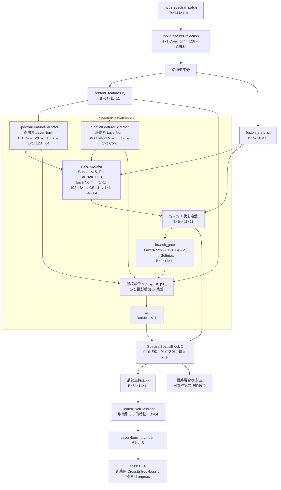

# StateFusionHSI：可更新融合状态的 HSI Patch 分类模型

输入为中心像素周围的 HSI patch，输出该中心像素的类别 logits。
默认适配 Houston 2013（项目标识 `HUST2013`）：144 波段、11×11 patch、15 类。
模型文件：`model/StateFusionHSI.py`。仅依赖 PyTorch。

当前按用户要求已移出命令行注册表，模型代码与历史实验记录保留。
以下结构说明和 Python 直接调用仍适用；当前注册模型与训练命令参见 `docs/modelselect.md`。

## 设计来源与本次变化

主要参考 `model/s2mamba.py` 的“输入投影 → 空间/光谱并行提取 → 融合 → 残差”信息流。
原实现的 PCS/BSS 内部分别生成用于调制输出的 z，SMG 负责融合两分支。
本模型使用一个显式跨块传递的 `fusion_state`：先接收本块两支提取结果，更新自身，
再生成融合比例。下一块同时接收新的主特征和新的融合状态。

第一版提取器采用简单卷积，不复现 PCS/BSS 的 Mamba 扫描；也不引入树、RWKV、
Transformer 或 GRU。结构差异集中在状态更新与融合信息流，效果尚需完整训练验证。
现有参考模型文件未改动。

## 完整数据流



`z₂` 不单独拼接到分类头，它已通过第二块的门控影响 `x₂`。
更新时不使用 detach，无跨样本缓存，也没有额外的状态监督损失。

## 三个可替换模块

| 模块属性 | 变量与输入 | 输出 | 默认算子 |
|---|---|---|---|
| `spectral_extractor` | `content_features`，B×D×H×W | `spectral_features`，同尺寸 | 每像素独立通道 MLP：1×1 卷积 D→2D→D |
| `spatial_extractor` | `content_features`，B×D×H×W | `spatial_features`，同尺寸 | 3×3 逐通道空间卷积 + 1×1 投影 |
| `feature_fusion` | 主特征、旧状态、光谱特征、空间特征 | 更新后的主特征与状态，均为 B×D×H×W | 非线性状态更新、两分支 Softmax 门控、残差融合 |

这里“光谱”分支混合的是投影后的隐通道，不沿原始波段顺序扫描。
`PixelChannelNorm` 只在一个像素的通道上归一化，不混合空间位置或 batch 样本。
门控权重为 B×2×H×W，同位置所有通道共享一对权重，两支权重之和为 1。

对于第 t 个块（S 为光谱，P 为空间）：

```text
spectral_features = SpectralExtractor(content_features)
spatial_features  = SpatialExtractor(content_features)
updated_fusion_state = fusion_state + Update([fusion_state, spectral_features, spatial_features])
branch_weights = Softmax(Gate(updated_fusion_state), dim=branch)
fused_features = spectral_weight * spectral_features + spatial_weight * spatial_features
updated_content_features = content_features + Project(fused_features)
```

默认两个块，均不降采样。由于空间提取器只使用一次 3×3 卷积，最终中心输出的
最大空间感受野是 5×5；11×11 patch 外围并未全部参与中心预测。
若后续需要覆盖更大邻域，可单独替换空间提取器，或研究块数的影响。
这是当前简化版的明确限制，不能声称它具有全 patch 的全局建模能力。

## 使用与模块替换

本模型不再支持 `python main.py --model state_fusion`，使用下面的 Python 接口。

`feature_dim` 和 `num_blocks` 不作为命令行参数。修改架构时直接编辑
`model/StateFusionHSI.py` 中 `StateFusionHSI.__init__` 的默认值：
`feature_dim=64, num_blocks=2`。
直接在 Python 中实例化模型时，仍可显式传入它们。

数据复用 `Config_for_datasets/Config.py` 和 `Mydataset/High_Dataset.py`。
当前配置读取 Houston 的 `3%...WindowSize11.npy` 文件：训练 450、验证 450、测试 14129 个样本。
`--windows` 用于校验已保存 patch 的尺寸，不会重新生成数据。

直接使用模型：

```python
import torch
from model.StateFusionHSI import StateFusionHSI, SpectralSpatialBlock

model = StateFusionHSI(in_channels=144, num_classes=15, feature_dim=64, num_blocks=2)
patches = torch.randn(4, 144, 11, 11)
logits = model(patches)  # [4, 15]，不提前 softmax
content_features, fusion_state = model.forward_features(patches)

# 自定义提取器必须保持 [B,64,H,W] 输入输出。
# 替换应在创建 optimizer 之前完成。
# model.blocks[0] = SpectralSpatialBlock(64, spectral_extractor=my_spectral_module)
# model.blocks[1].spatial_extractor = my_spatial_module
```

## 训练与评估的必要修正

- 沿用原数据加载、SGD、学习率计划、交叉熵、验证和测试流程。
- 训练仍丢弃尾批；验证和测试使用固定顺序并保留全部样本。
- 最佳验证轮次保存独立权重快照，训练结束恢复该快照再测试。
- 重复实验的代表性权重按验证准确率选择，测试均值和标准差仍覆盖所有重复。
- `--weight-decay` 正确传给 SGD 的 `weight_decay`，不再误传为 `dampening`。

上述流程修正也适用于同入口的其他模型，因此新实验不应直接视为旧记录的同协议复现。
这些是此前基线实现时的流程修正；本次模型注册重构没有再次修改训练规则。

## 验证命令

```bash
python -m unittest discover -s tests -p 'test_state_fusion.py' -v
```

测试覆盖 Houston 前向/反向、所有状态梯度、状态跨块传递、状态干预对预测的影响、
空间与光谱分支的不同空间依赖、batch 独立性、权重往返保存、评估完整覆盖和最佳权重恢复。
两轮短训练仅验证流程能跑通，不代表正式性能结果。

## 本次验证结果

- 7 项针对性测试全部通过；默认模型参数量为 105,555。
- 使用 `hsi_env` 的 PyTorch 2.5.1，CPU 执行 Houston 全数据两轮训练、验证和测试。
- 训练损失从 2.6268 降到 2.1171；验证准确率从 29.78% 到 39.78%。
- 恢复第 2 轮的最佳验证权重后，测试覆盖全部 14,129 个样本；OA 为 32.72%。
- 此结果只证明端到端流程和学习信号正常，尚未做正式训练或性能调优。
- 运行产物：`model_pth/state_fusion_checks/HUST2013/runs/StateFusionHSI_smoke1015/`，
  包含配置、训练日志、逐轮指标、混淆矩阵和可加载权重。
