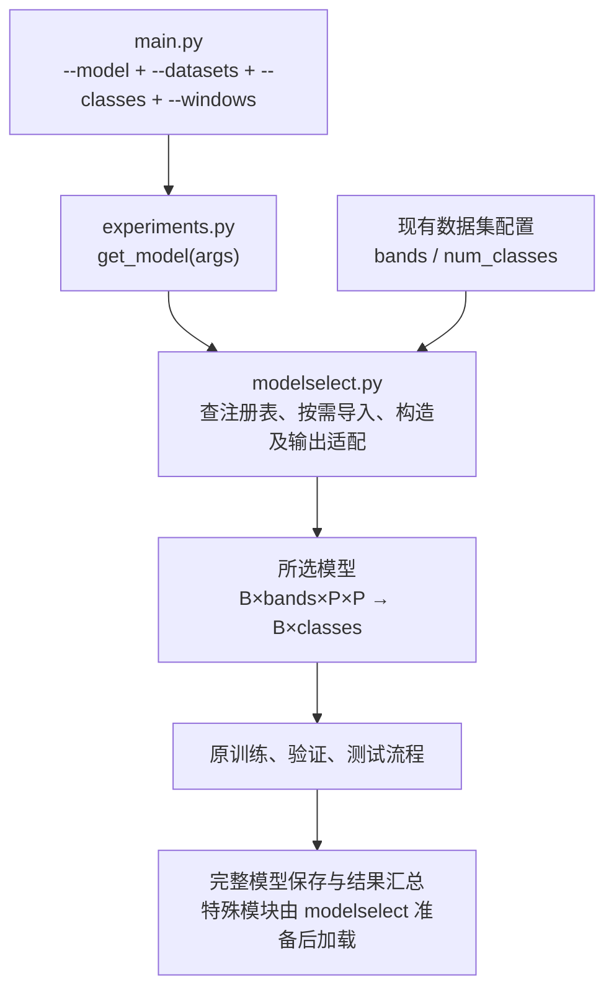
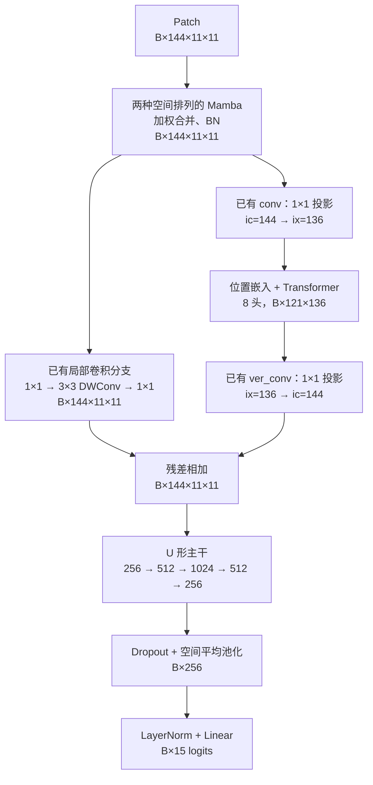

# 模型选择与 Demunet 数据集适配

## 职责

- `main.py`：解析 `--model`，选项来自同一注册表，默认 `s2mamba`。
- `functions/modelselect.py`：模型注册、按需导入、构造参数、输出适配及特殊权重加载。
- `functions/experiments.py`：数据、随机种子、重复实验、优化器和学习率计划、结果汇总。
- `train_function_new.py`、验证和测试代码继续接收单个 `[B, classes]` logits 张量。

`experiments.get_model(args)` 保留原返回接口 `(model, optimizer, scheduler)`，
创建模型只调用 `build_model(args)`。没有修改现有训练、评估、最佳权重选择规则。



## 注册表

| `--model` | 构造与输出处理 | 运行要求 |
|---|---|---|
| `s2mamba` | 原 PCS/BSS/SMG；depths=[1]、dims=[64]；直接 logits | CUDA、timm、mamba_ssm 扫描扩展 |
| `demunet` | 参数化波段数、类别数和窗口；直接 logits | PyTorch；本地 Mamba 扫描支持 CPU |
| `cpformer` | 沿用 `cpformer1` 包装；IP dim=256，其余 64 | PyTorch、einops |
| `ssftm` | channels=128、depths=[1]，沿用原扫描/融合配置 | CUDA、timm、匹配当前 Python/PyTorch 的 `_C` 扩展 |
| `hirwkv` | hidden_dim=128；分数图平均池化为 logits | CUDA 编译环境、mmcv、WKV 扩展 |
| `hybridformer` | dim=100、depth=4、heads=2、patch_size=[3,5] | PyTorch、einops |
| `sqsformer` | 读取原 sqsformer.json，覆盖数据集尺寸；取三元组第一个结果 | PyTorch、einops、torchvision、Pillow |
| `morphformer` | FM=16；沿用已有分类头适配；隔离导入时 summary 的随机数影响 | PyTorch、einops、torchsummary |

按要求未注册 `fbcanet`（消息中的 fbscanet）、`state_fusion`、`s2mamba_gdn`。
它们的模型文件保留，既不自动导入，也不作为 `--model` 可选项。
未选择的模型不会触发依赖检查或 CUDA 扩展加载；已选模型缺依赖时保留原异常原因，
并在错误消息中标明模型名称，不自动切换为其他模型。

模型结构参数在各自 `_build_...` 函数中维护，不新增 feature_dim 或 num_blocks 命令行参数。
SQSFormer JSON 中的训练 lr/epochs 不覆盖命令行设置；优化器和学习率计划仍由 experiments 管理。

## Demunet 的 ic 与 ix

```python
ic = in_channels
ix = ((ic - 1) // 8) * 8
```

| 输入波段数 `ic` | 注意力通道数 `ix` |
|---:|---:|
| Houston 144 | 136 |
| PU 103 | 96 |
| 104 | 96 |
| 145 | 144 |

减 1 保证严格小于 ic，包括 ic 已经能被 8 整除的情形。输入波段数必须大于 8。
每个模型对象分别保存自己的维度，不使用模块级 ic/ix，所以不同数据集对象互不影响。

```python
from model.demunet.model import MyModel

houston_model = MyModel(
    in_channels=144, num_classes=15, patch_size=11, batch_size=32
)
pu_model = MyModel(
    in_channels=103, num_classes=9, patch_size=11, batch_size=32
)
```

保留已有 `ic→ix→ic` 两个 1×1 投影及主干；将类别数和位置嵌入窗口也参数化，
避免修好输入后再次出现类别数或窗口维度不一致。窗口必须是至少 5 的奇数。
`batch_size` 是位置嵌入所支持的最大批量，验证/测试允许小于它的尾批。

Houston 数据流：



## 运行示例

在项目根目录 `/home/chenfl/Projects/HSI` 执行：

```bash
# 默认 s2mamba；需在具备相应 CUDA 扩展的环境运行
python main.py --exp_name s2mamba_houston --gpus 0

# Demunet：Houston 自动使用 ic=144、ix=136、15 类
python main.py --model demunet --exp_name demunet_houston --gpus 0

# Demunet：PU 自动使用 ic=103、ix=96、9 类
python main.py --model demunet --exp_name demunet_pu --datasets PU --classes 9 --gpus 0

python main.py --model sqsformer --exp_name sqsformer_houston --gpus 0
```

省略 `--gpus` 时沿用原设备选择：有 CUDA 则使用 cuda:0，否则 CPU。
原始 S2Mamba、SSFTM、Hi-RWKV 在 CPU 上会明确提示需要 CUDA；其他模型可用于 CPU 检查。
`--windows` 检查已有 patch 数据尺寸，不会生成新数据。

## 权重与验证

SQSFormer 包装类移入 modelselect；experiments 保留同名导入，兼容旧完整模型的类路径。
SSFTM 保持旧 `ssftm_model` 动态模块名，主进程加载前会准备对应模块。
Demunet 若旧权重的 ix 与新构造模型不同，不能直接严格加载 state_dict，应按新维度重新训练。

```bash
python -m unittest discover -s tests -p 'test_modelselect.py' -v
python -m unittest discover -s tests -p 'test_state_fusion.py' -v
```

验证包括注册范围、默认名称、按需导入、输出适配、旧 SQSFormer 权重在新进程加载、
Demunet Houston/PU 的前向与尾批、严格小于关系、投影反向梯度及缺依赖的错误提示。
GPU 专用模型需要在具备相应 CUDA 环境的机器完成实际前向检查。

本次在 CPU 环境中通过了 10 项注册/适配测试和 7 项原基线测试。
Demunet、CPFormer、SQSFormer、HybridFormer、MorphFormer 均完成 Houston 前向检查；
Demunet 完成 Houston/PU 尺寸检查、尾批和反向传播检查。
CPFormer 还通过原入口完成 Houston 全数据的一轮训练、验证、测试与完整模型保存/加载，
测试覆盖全部 14,129 个样本。短训练仅用于验证接口，没有评估正式性能。
原始 S2Mamba、SSFTM、Hi-RWKV 的 GPU 前向尚未在此环境验证。

此前提供的 `docs/rollback_optional_pipeline.patch` 已按新的文件布局更新，未应用；
如需撤销先前的额外训练流程修正，该补丁保留本次注册表和 Demunet 适配。
